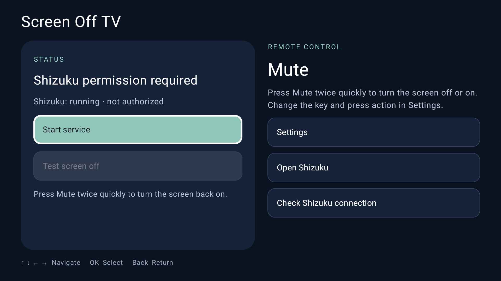

# Screen Off TV — Turn off the TV screen while audio keeps playing

[**Installation guide with screenshots**](docs/INSTALL.en.md) · [**AI agent installation guide**](docs/AGENT-INSTALL.md)

**English** · [Tiếng Việt](README.vi.md) · [简体中文](README.zh-CN.md)

Screen Off TV lets you **turn off the Android TV screen with your remote while music or video keeps playing**. Listen to music, podcasts, lectures or movie audio without keeping the screen on. The app uses **Shizuku** and supports English, Vietnamese and Simplified Chinese. Screen control and continued audio playback depend on the TV and player.

Tested on **Xiaomi TV A Pro 55-inch (2026)** with stable operation.



## Features

- Turn the screen off and back on with a single press, double press or 0.6-second hold on the remote.
- Choose Mute, Volume Up, Volume Down or learn another remote key. New keys are saved after confirmation and retain their original TV function.
- Choose **Screen Off / Picture Off** or **Backlight off**.
- Start automatically with the TV; this can be disabled in Settings.
- Navigate with the remote's arrow keys and OK.
- Choose English, Vietnamese, Simplified Chinese or **Follow system**.

## Requirements

- Android TV 8.0 or later.
- Shizuku running and authorized for Screen Off TV.
- Starting Shizuku through Wireless debugging as described in the guide requires Android 11 or later and a TV with **Wireless debugging** available.

Screen Off TV controls the display. It does not play music or video or add background playback to other apps.

## Download and install

Current download: **0.1.2**, signed with an Android debug key.

1. Install and start the [thedjchi/Shizuku TV fork](https://github.com/thedjchi/Shizuku) using the [illustrated installation guide](docs/INSTALL.en.md).
2. Download [Screen-Off-TV-0.1.2.apk](https://github.com/ThaiVanCuong93/ScreenOffTV/raw/refs/heads/main/dist/Screen-Off-TV-0.1.2.apk). Compare its SHA-256 with [SHA256SUMS](dist/SHA256SUMS).
3. Install the APK, open Screen Off TV and select **Start service**.
4. When Shizuku asks for permission, select **Allow all the time**. Wait for **Ready to control** and **Shizuku: running · authorized**.
5. Open **Settings** to choose the remote key, press action, screen-off mode and language. Stop the service before changing screen-off modes.

You can also build the APK using the instructions below.

## How to use

The default shortcut is **Mute, pressed twice quickly**.

1. Start the Screen Off TV service and check for **Ready to control**.
2. Start music or a video in your usual player and confirm that sound is playing.
3. Press Mute twice quickly to turn off the screen.
4. Press Mute twice quickly again to restore the picture.

If you changed the key or action, use your selected shortcut instead. The key retains its original TV function, so check it before use. Do not assign Power, OK, Back or arrow keys as shortcuts.

If audio stops, restore the picture and check the player. You can try the other screen-off mode after stopping the service. If the shortcut cannot restore the picture, use the TV's restart or power controls to recover.

### Change the remote key

Open **Settings → Remote key** and select a preset or **Set custom remote key** (**Learn another remote key** in 0.1.2). Press the desired key, then select **Confirm this key** to save it. Starting with **0.1.3**, confirmation closes the dialog.

See the [RED button walkthrough](docs/INSTALL.en.md#8-optional-red-button) for a step-by-step example.

## Screen-off modes

| Mode | How it works |
|---|---|
| **Screen Off / Picture Off** — default | Turns off the display while the TV keeps running. Requires firmware that supports display control through Shizuku. |
| **Backlight off / Brightness = -1** | Turns off the backlight and restores the saved brightness when the picture returns. Requires firmware support for this brightness value; brightness 0 is only the minimum level. |

Stop the service before changing modes. Neither mode sends a power-off or standby command. Continued audio playback depends on the TV and player.

## Start automatically with the TV

**Start when TV boots** is enabled by default. Also enable **Start on boot** in Shizuku and keep Wi-Fi available after the TV boots.

If Shizuku starts late and Screen Off TV reports an error, wait for Shizuku to run and restart the app service. If you disabled automatic startup, the app preserves that choice when reopened.

See [Shizuku startup setup](docs/INSTALL.en.md#5-enable-shizuku-start-on-boot) and [how to check after a reboot](docs/INSTALL.en.md#9-test-pictureaudio-and-boot-recovery).

## Tested devices

| Device | Result |
|---|---|
| Xiaomi TV A Pro 55-inch (2026) | Stable operation in everyday use. |
| Xiaomi MiTV-MZTU0 — Android 14 | UI, languages and settings checked with 0.1.2. Two reboots performed; on the second, Shizuku and Screen Off TV started before either app was opened. |

Results were recorded on **2026-10-25**. Specific players and usage durations have not been recorded for each device. See the [test details](docs/TESTING.md) for the scope of the checks.

When reporting a problem or results on another TV, include its model, Android version, Shizuku and Screen Off TV versions, player, screen-off mode and what happened.

## Languages

The default is **Follow system**. Open **Settings → Language** to choose **Follow system**, **Tiếng Việt**, **English** or **简体中文**.

If the TV language is unsupported, the app uses English. Your selection is saved. Changing language does not change remote settings or restart the running service.

## Build and test

Current source: **0.1.3** (versionCode 3). The APK linked for download above is **0.1.2**.

Application ID: `com.thaivancuong93.screenofftv`. Requires JDK 17 and Android SDK platform 35. Configure `JAVA_HOME` and `ANDROID_HOME` for your machine.

Build the APK and run unit tests:

```bash
./gradlew :app:assembleDebugSignedDebug :app:testDebugSignedDebugUnitTest :ipc:testDebugUnitTest
```

The APK is created at `app/build/outputs/apk/debugSigned/debug/app-debugSigned-debug.apk`, signed with an Android debug key.

UI and language tests require a connected Android device:

```bash
./gradlew :app:connectedDebugSignedDebugAndroidTest
```

Build an unsigned release:

```bash
./gradlew :app:assembleUnsignedRelease
```

Sign it with your release key before distribution.

## Project structure

- `app/`: TV interface, languages, remote settings, background service and tests.
- `hidden-api/`: Android display API access.
- `ipc/`: data exchanged between processes.
- `shizuku-service/`: display control and remote input through Shizuku.
- `design/`: original icon artwork.
- `fastlane/`: English, Vietnamese and Simplified Chinese distribution metadata.

## Privacy and license

Preferences are stored on the device. The app has no ads, behavioral analytics or user-data upload service. Android may back up preferences according to the device settings.

This project uses and modifies GPL v3 source code. See [LICENSE](LICENSE) and [THIRD_PARTY_NOTICES.md](THIRD_PARTY_NOTICES.md) for source attribution and dependency notices.
