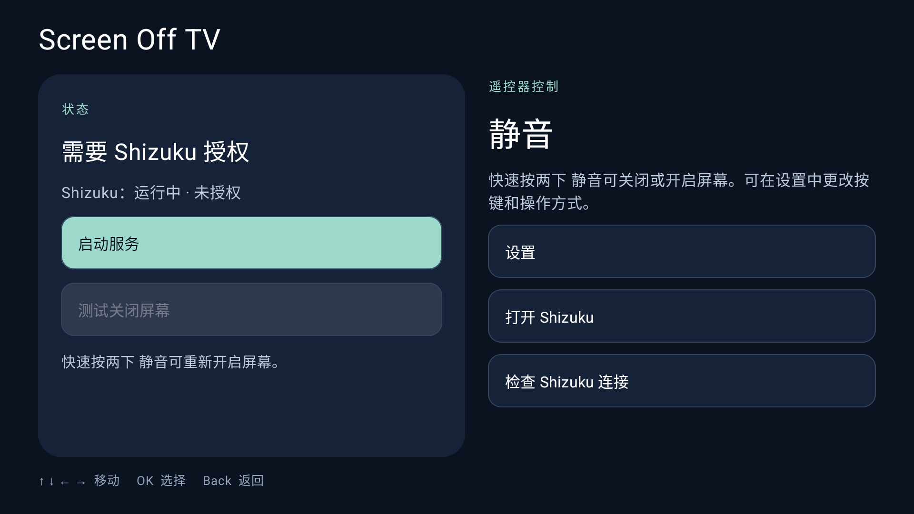

# Screen Off TV — Android TV 息屏听歌，关闭画面保留声音

[**带电视截图的分步安装指南**](docs/INSTALL.zh-CN.md) · [**AI 安装指南（英语）**](docs/AGENT-INSTALL.md)

[English](README.md) · [Tiếng Việt](README.vi.md) · [简体中文](README.zh-CN.md)

**关闭 Android TV 屏幕，同时继续听音乐或电影、视频的声音。** Screen Off TV 是通过遥控器操作的电视息屏应用，让您无需保持画面也能收听歌曲、播客或电影对白。应用依赖 **Shizuku**，支持英语、越南语和简体中文。屏幕控制及能否继续播放取决于电视固件和播放器。

[GitHub 仓库](https://github.com/ThaiVanCuong93/ScreenOffTV)

项目维护者反馈：在 **Xiaomi TV A Pro 55 英寸 2026 款** 上运行稳定。此使用反馈与下方自动化测试分开记录。



## 电视息屏听歌和收听电影音轨

### 音乐和播客

先在常用的电视播放器中播放音乐或播客，再使用已设置的遥控快捷操作关闭画面。在设备和播放器支持的情况下，声音可以继续播放。需要换歌或浏览内容时，再次使用相同操作开启屏幕。

### 电影和视频声音

如果只想听电影对白、音乐会、课程或视频的声音，可以让内容继续播放并关闭画面。Screen Off TV 负责控制屏幕，不提供内容播放，也不会为其他播放器增加后台播放功能。

## 功能

- 通过 Shizuku 启动、停止服务并检查连接。
- 选择静音键、音量增加键、音量减小键，或识别其他遥控按键；保存前需要确认。
- 通过单击、双击或长按 0.6 秒关闭和开启屏幕。按键仍保留电视上的原有功能。
- 选择 Screen Off / Picture Off（默认），或通过亮度 -1 关闭背光。
- 测试息屏前显示确认提示；开机自启动默认开启，可在设置中关闭。
- 使用方向键和 OK 操作。在“关于应用”中用 ↑/↓ 滚动，用 OK 或 Back 关闭。
- 支持英语、越南语和简体中文，也可跟随电视语言。不支持的语言回退为英语。

## 下载 APK、安装与 Shizuku 授权

需要 Android TV 8.0 或更高版本，以及已运行并向 Screen Off TV 授权的 Shizuku。

1. 按照[图文指南](docs/INSTALL.zh-CN.md)安装并启动 [thedjchi/Shizuku TV fork](https://github.com/thedjchi/Shizuku)。
2. 下载 [Screen-Off-TV-0.1.2.apk](https://github.com/ThaiVanCuong93/ScreenOffTV/raw/refs/heads/main/dist/Screen-Off-TV-0.1.2.apk)，并与 [SHA256SUMS](dist/SHA256SUMS) 核对 SHA-256。也可按下方说明自行构建。
3. 安装 APK，打开 Screen Off TV，选择 **启动服务**，并在提示时授予 Shizuku 权限。
4. 打开 **设置**，选择遥控按键、按键操作、息屏模式和语言。更改息屏模式前请先停止服务。
5. 测试遥控按键，然后使用所选操作关闭和重新开启屏幕。

开机自启动需要 Shizuku 已运行并获授权。不能将电源、OK、Back 或方向键设为快捷键。

## 如何使用遥控器关闭并重新开启屏幕

默认快捷操作是 **快速按两下静音键**。在 **设置** 中可选择单击、双击或 **长按 0.6 秒**，也可识别其他按键。按键仍保留电视上的原有功能，请先测试再使用。电源、OK、Back 和方向键保留用于电视的基本操作。

1. 开始播放音乐或视频，确认已有声音。
2. 打开 Screen Off TV，启动服务并授予 Shizuku 权限。
3. 返回播放器，使用已设置的遥控操作关闭画面。
4. 再次使用相同操作重新开启屏幕。

如果播放停止或屏幕没有响应，请重新开启画面并检查息屏模式和播放器。不能假定所有电视或应用都支持息屏继续播放声音。

## Screen Off / Picture Off 与关闭背光模式

| 模式 | 行为 | 条件 |
|---|---|---|
| Screen Off / Picture Off — 默认 | 请求 Android 关闭屏幕面板，同时让电视继续运行。 | 已授予 Shizuku 权限，且电视显示 API 兼容。 |
| 关闭背光 / Brightness = -1 | 请求关闭背光，重新开启画面时恢复已保存亮度。亮度 0 仅为最低亮度。 | 已授予 Shizuku 权限，且固件支持该亮度操作。 |

更改模式前请先停止服务。Screen Off TV 不发送电视关机或待机命令，目标是在屏幕关闭时保持电视和播放器运行。

## 兼容性和已验证结果

应用要求 Android TV 8.0 或更高版本，但不代表所有电视都兼容。下表对应 **0.1.2**，检查日期为 **2026 年 10 月 25 日**。

| 设备 | Android | 播放器 / 范围 | 模式 | 已验证结果 |
|---|---|---|---|---|
| Xiaomi TV A Pro 55 英寸 2026 款 | 反馈中未记录固件 | 维护者使用反馈 | 未记录模式 | 维护者反馈运行稳定；尚未记录播放器、持续时间和重启细节。 |
| Xiaomi MiTV-MZTU0 | 14 / API 34 | 界面、语言、设置和方向键 | 界面配置 | 6 项 Android 测试通过，包括关于页面滚动和语言切换。 |
| Xiaomi MiTV-MZTU0 | 14 / API 34 | 音乐或电影播放 | Screen Off / Picture Off | 尚未记录具体播放器的面板控制和声音连续播放结果。 |
| Xiaomi MiTV-MZTU0 | 14 / API 34 | 音乐或电影播放 | 关闭背光 | 尚未记录具体播放器的面板控制和声音连续播放结果。 |
| Xiaomi MiTV-MZTU0 | 14 / API 34 | 开机自启动选项 | 不适用 | 已测试默认开启并保留关闭选择。已重启两次；第二次使用 thedjchi/Shizuku 13.7.0，在打开应用前确认两个服务运行。 |

报告其他设备时，请提供型号、Android、播放器及版本、模式，以及实际画面和声音结果。

## 常见问题

### 能否关闭电视画面但保留声音？

这正是应用的目标：让 Android TV 息屏后继续听歌或视频声音。但需要兼容的电视，以及会继续播放的播放器。上表区分了已验证的界面功能与仍待确认的播放情况。

### 应用会关闭电视电源或使电视进入待机吗？

不会。Screen Off TV 请求控制屏幕面板或背光，让 Android 和播放器保持运行。电视电源键的用途不同。

### 为什么需要 Shizuku？

Shizuku 提供普通 Android 应用无法直接使用的屏幕操作和遥控输入访问能力。请安装并启动 Shizuku，再向 Screen Off TV 授权。

### 如何重新开启画面？

再次执行已设置的遥控操作。默认是快速按两下静音键。请在屏幕仍亮着时测试并记住按键，再尝试息屏。

### 所有音乐或视频应用都会继续播放吗？

不一定。播放器或电视固件可能暂停播放或拒绝屏幕控制请求。只有经过实际测试后，才能记录某个播放器兼容，不能承诺所有应用都支持。

### 电视开机后服务会自动启动吗？

开机自启动默认开启，可在设置中关闭；用户主动保存的关闭选择会被保留。Shizuku 仍需已运行并获授权。已在测试电视上使用 thedjchi/Shizuku 13.7.0 验证重启恢复，详见安装指南和测试记录。

### 支持哪些语言？

支持英语、越南语和简体中文。**跟随系统** 使用支持的电视语言，没有可用语言时回退为英语。

### 在哪里下载 APK？

从本仓库下载 [Screen-Off-TV-0.1.2.apk](https://github.com/ThaiVanCuong93/ScreenOffTV/raw/refs/heads/main/dist/Screen-Off-TV-0.1.2.apk)，并使用 [SHA256SUMS](dist/SHA256SUMS) 核验。这是使用 Android 调试密钥签名的测试版本。

## 语言

在 **设置 → 语言 / Language** 中选择 **跟随系统**、**Tiếng Việt**、**English** 或 **简体中文**。选择会被保存。切换语言会保留遥控设置，且不会重启正在运行的服务。

## 构建与测试

版本：**0.1.2**（versionCode 2）。应用 ID：`com.thaivancuong93.screenofftv`。
需要 JDK 17 和 Android SDK platform 35。请根据本机环境设置 `JAVA_HOME` 和 `ANDROID_HOME`。

```bash
./gradlew :app:assembleDebugSignedDebug :app:testDebugSignedDebugUnitTest :ipc:testDebugUnitTest
```

APK：`app/build/outputs/apk/debugSigned/debug/app-debugSigned-debug.apk`。此构建使用 Android 调试签名密钥。本地准备好的 APK 名为 `Screen-Off-TV-0.1.2.apk`。

界面和语言测试需要连接 Android 设备：

```bash
./gradlew :app:connectedDebugSignedDebugAndroidTest
```

构建未签名的发布版本：`./gradlew :app:assembleUnsignedRelease`。分发前请使用自己的发布密钥签名。

## 项目结构

- `app/`：电视界面、语言资源、遥控设置、后台服务和测试。
- `hidden-api/`：访问 Android 屏幕 API。
- `ipc/`：进程间通信的结果类型。
- `shizuku-service/`：通过 Shizuku 控制屏幕并接收遥控输入。
- `design/`：项目所有者提供的原始图标素材。
- `fastlane/`：英语、越南语和简体中文的分发信息。

## 隐私与许可证

设置保存在设备本地。应用不含广告、行为分析或将用户数据上传到服务器的服务。Android 可能根据设备配置备份设置。

本项目使用并修改 GPL v3 源代码。源码来源和依赖声明请参阅 [LICENSE](LICENSE) 和 [THIRD_PARTY_NOTICES.md](THIRD_PARTY_NOTICES.md)。
