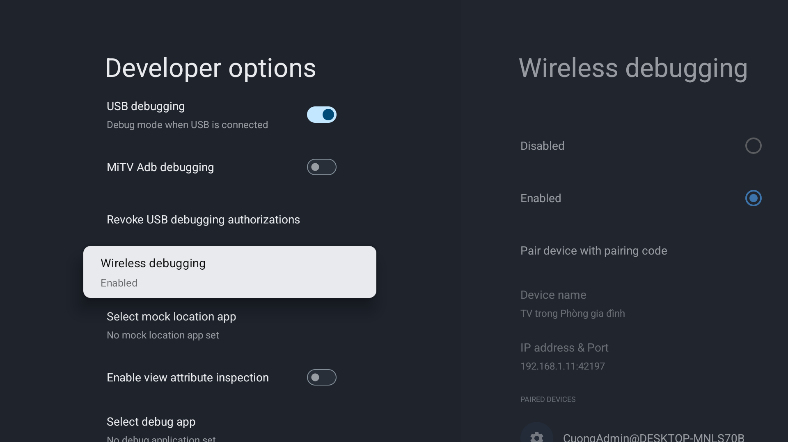
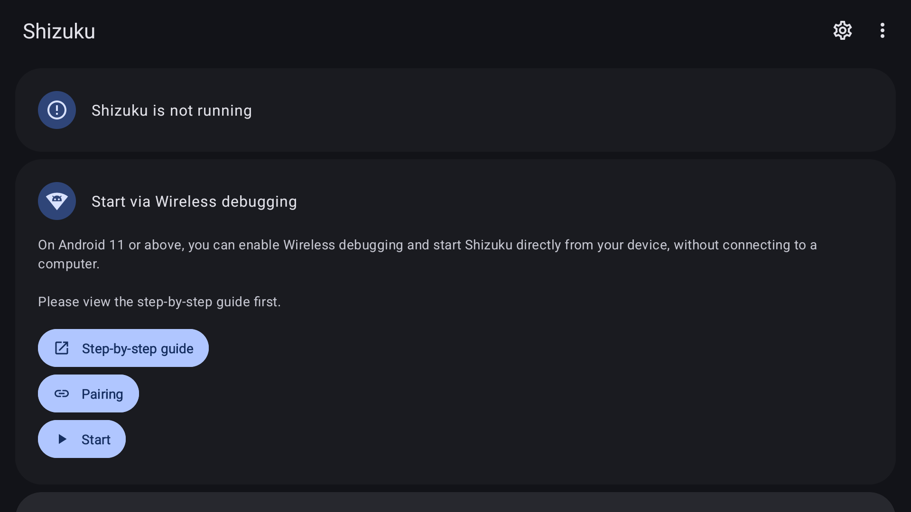
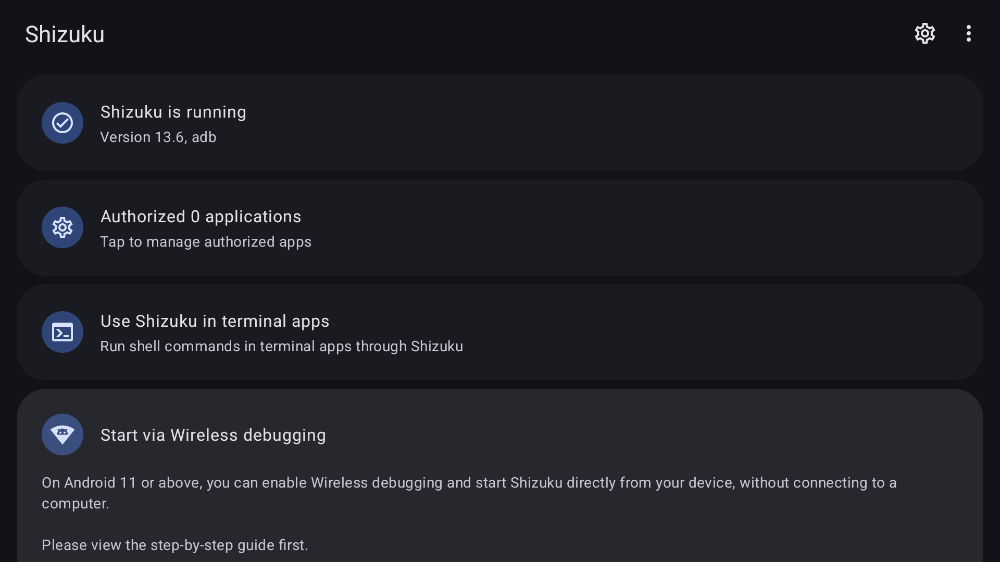
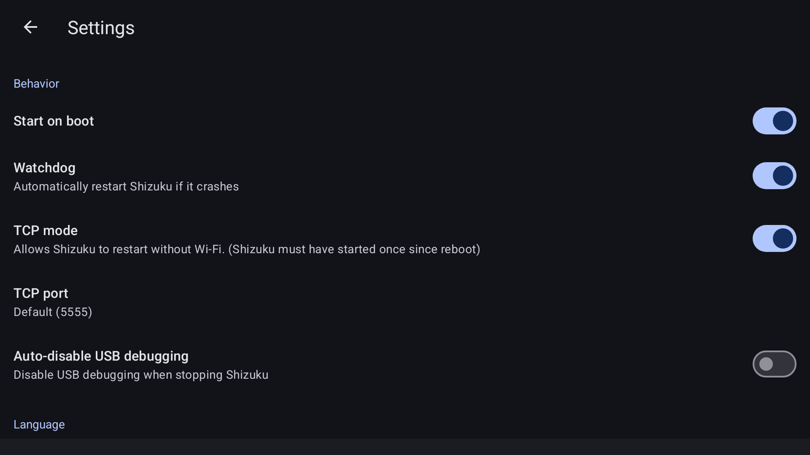
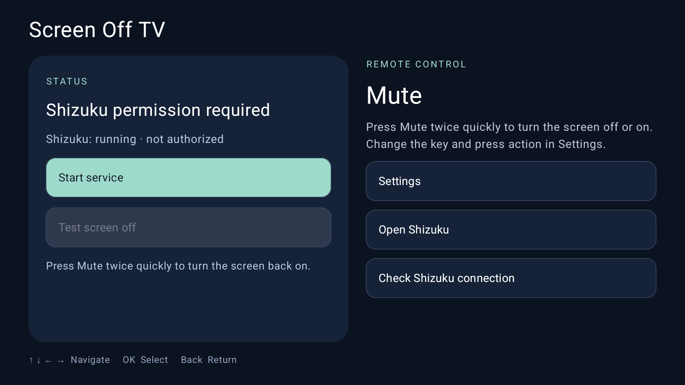
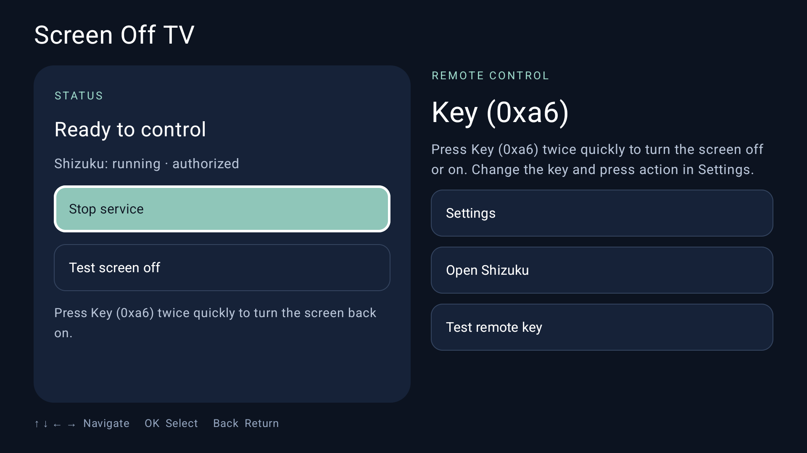
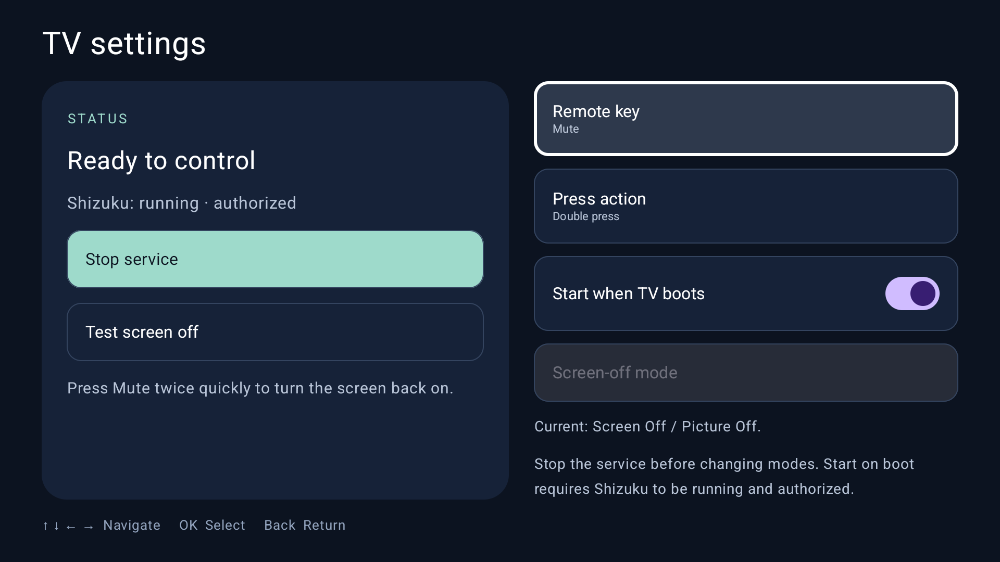
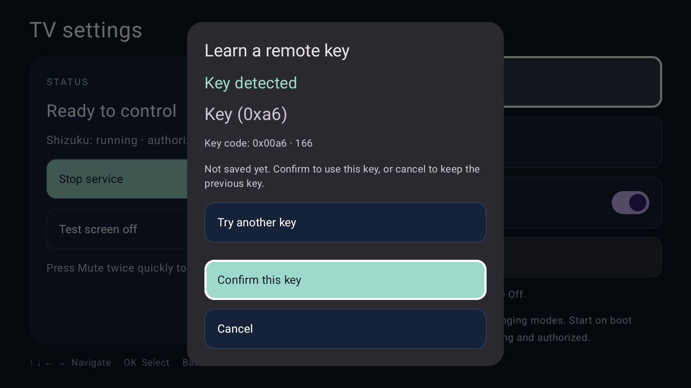
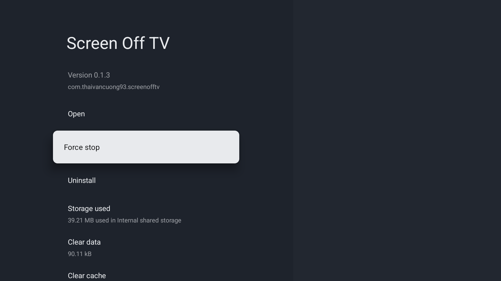

# Install Screen Off TV on Android TV / Google TV

**English** · [Tiếng Việt](INSTALL.md) · [简体中文](INSTALL.zh-CN.md) · [AI agent runbook](AGENT-INSTALL.md) · [README](../README.md)

Follow this order: **install Shizuku → connect Shizuku to the TV → enable Shizuku startup on boot → install Screen Off TV → authorize → check the features**. Screenshots are from the TV with its interface set to English.

## 1. Download both APKs first

You need a TV connected to Wi-Fi, its remote, and either a computer with [Google Platform Tools](https://developer.android.com/tools/releases/platform-tools) or a USB drive and TV file manager. Screen Off TV requires Android TV 8.0 or later; compatibility depends on the firmware. Starting Shizuku through Wireless debugging requires Android 11 or later and firmware that exposes this setting.

| App | Project | Download |
|---|---|---|
| TV-compatible Shizuku fork, 13.7.0-thedjchi | [Release](https://github.com/thedjchi/Shizuku/releases/tag/v13.7.0-thedjchi) | [APK](https://github.com/thedjchi/Shizuku/releases/download/v13.7.0-thedjchi/shizuku-v13.7.0-thedjchi.apk) |
| Screen Off TV 0.1.3 | [Repository APK page](https://github.com/ThaiVanCuong93/ScreenOffTV/blob/codex/publish-source/dist/Screen-Off-TV-0.1.3.apk) | [APK](https://github.com/ThaiVanCuong93/ScreenOffTV/raw/refs/heads/codex/publish-source/dist/Screen-Off-TV-0.1.3.apk) |

On GitHub's APK page choose Download raw file. Compare SHA-256 with `sha256sum FILE.apk` on Linux or `Get-FileHash FILE.apk -Algorithm SHA256` in PowerShell. Do not install an HTML page renamed to APK.

```text
shizuku-v13.7.0-thedjchi.apk
6ea6dee65d5ddc626b6b75b2c2f67f8cc547fa47d7b437e6892639c37eaffe43
Screen-Off-TV-0.1.3.apk
74b80f20adcba6c4e91034b3e581b672dd01c285e5ad879dfadf6d1816cb4b36
```

## 2. Enable Developer options and debugging

1. Settings → System / Device preferences → About → Android TV OS Build. Press OK about seven times until the developer confirmation appears; enter the TV lock code if asked.
2. Return to System / Device preferences → Developer options. Leave its main switch on.
3. Find Debugging and enable USB debugging.
4. Open **Wireless debugging → Enabled**; accept your own trusted network prompt if shown. Do not enable OEM unlocking or root the TV.



The screenshot shows USB debugging and Wireless debugging enabled.

## 3. Install Shizuku first

**USB:** copy the Shizuku APK to a USB drive, attach it to the TV, open the TV file manager and select the Shizuku APK. If blocked, Settings → Apps → Special app access → Install unknown apps → allow that file manager only. Return to the APK → Install → Open. Revoke the file manager's installer permission afterwards if desired. Do not disable protection to bypass an unexplained warning.

**Computer:** connect using the TV's actual pairing and connection ports (they are different), enter its current code when prompted and approve your own computer:

```bash
adb pair TV_IP:PAIRING_PORT
adb connect TV_IP:CONNECTION_PORT
adb devices -l
adb -s TV_SERIAL install shizuku-v13.7.0-thedjchi.apk
```

Replace uppercase placeholders with observed values. If the firmware provides an authorized legacy network ADB route, use that route; do not assume every TV uses port 5555. A paired computer does not pair Shizuku itself.

Open Shizuku from the launcher or Settings → Apps → Shizuku → Open.



The message **Shizuku is not running** means the Shizuku service has not started. It changes to **Shizuku is running** after a successful start.

## 4. Connect Shizuku to the TV

1. In Shizuku, select **Start via Wireless debugging → Start**.
2. If the TV shows **Allow USB debugging**, select **Always allow from this computer** and **Allow** for your connection. Wait for startup to finish; the command window closes automatically.
3. If startup fails or Shizuku asks to pair, select **Pairing → Developer options → Wireless debugging → Pair device with pairing code**. Leave the code screen open for Shizuku to detect it, then return and select **Start**. Pairing the computer through ADB does not replace Shizuku's own pairing.
4. Check that the status is **Shizuku is running**.



If Wireless debugging is unavailable, select **Start by connecting to a computer → View command** in Shizuku and run the displayed command through ADB. Check boot recovery separately when using this method.

The fork's app version 13.7.0 can display server version 13.6 on Home. Check About or Android app information for the app version `13.7.0-thedjchi`.

## 5. Enable Shizuku Start on boot

Shizuku → gear icon → Settings → enable **Start on boot**. If setup requests WRITE_SECURE_SETTINGS, use authorized computer ADB:

```bash
adb -s TV_SERIAL shell pm grant moe.shizuku.privileged.api android.permission.WRITE_SECURE_SETTINGS
```

Keep Wi-Fi available after reboot. Use firmware-specific app background controls only if they exist.



The screenshot shows TCP and Watchdog enabled. TCP is not required on every TV. Watchdog can restart Shizuku if its service stops; it does not replace startup on boot.

**Note:** Automatic startup needs the connection in step 4, Start on boot enabled and Wi-Fi available after boot. Startup time depends on the TV and Wi-Fi connection. Screen Off TV keeps waiting and connects automatically when Shizuku is ready, even after more than 30 seconds. Failed service connections are retried automatically. Check automatic startup in step 9.

## 6. Install and authorize Screen Off TV

Install its APK through the USB flow in step 3 or:

```bash
adb -s TV_SERIAL install Screen-Off-TV-0.1.3.apk
```

Open Screen Off TV → Start service. A fresh install may initially report Shizuku permission needed:



Choose Allow all the time in Shizuku's prompt. Accept the app's notification permission if the TV asks.



Wait for Ready, Shizuku running and permission granted. Otherwise check Shizuku first, then Check Shizuku connection or restart the service.

## 7. Confirm app defaults

Open **Settings** and check:

| Setting | Default |
|---|---|
| Remote key | Mute |
| Press action | Double press |
| Start when TV boots | On |
| Screen-off mode | Screen Off / Picture Off |
| Language | Follow system |



Screen Off TV has its own boot switch. Enable Shizuku's **Start on boot** in step 5 as well. Stop the service before changing screen-off modes. Change language under **Settings → Language**. Ordinary updates preserve saved preferences.

## 8. Optional RED button

The default shortcut is **Mute, double press**. To use the RED button:

1. Start the service, then open **Settings → Remote key → Set custom remote key**.
2. In **Learn a remote key**, press RED once on the remote. Do not use Power, OK, Back or navigation keys.
3. When **Key detected** appears, select **Confirm this key** to save it, or **Try another key** to choose again. Confirmation closes the dialog.
4. Keep **Press action → Double press** for the default gesture. Open **Test remote key** and press RED once to check reception.



## 9. Test picture/audio and boot recovery

**Check picture and audio:** Start music or a video and confirm sound is playing. Use the selected shortcut (Mute twice quickly by default) to turn off the picture and check that audio continues. Repeat the shortcut to restore the picture. The key keeps its original TV function, so check that function first. If the picture cannot be restored, use the TV's restart or power controls to recover.

**Check automatic startup:** Restart the TV through its system menu and wait for Wi-Fi and Shizuku. Waiting time depends on the TV and Wi-Fi connection. **Before opening Shizuku or Screen Off TV, do not select Start service or run a computer starter command.** Start music or a video, confirm sound, then use the shortcut to turn the picture off and back on. If the picture responds and audio continues, automatic startup worked in this run.

If it fails, check both boot switches and whether Shizuku is running. If opening an app or starting its service manually is required, automatic startup did not pass. Include the TV model, Android version, both app versions and displayed status when reporting a problem. Keep Wi-Fi available after reboot.



Screen Off TV **0.1.2** was rebooted twice on 2026-10-25. On the second reboot, `shizuku_server` and the foreground Screen Off TV service ran **before app launch**; Android recorded `BOOT_COMPLETED`. The image illustrates the ready state after a reboot. Results apply to the tested TV and firmware. Named-player playback and physical RED testing were not included in that recorded boot test.

## 10. Troubleshooting

| Problem | Next step |
|---|---|
| Screen Off TV does not start after reboot | Check authorization, the app's Start when TV boots setting and whether Shizuku started automatically. |
| Shizuku cannot connect | Check Wi-Fi, USB debugging and Wireless debugging. |
| Permission denied | Start the service and select Allow all the time in Shizuku; check authorized apps if previously denied. |
| Shizuku ready but app timed out | Wait for automatic reconnection. If the error persists, record the displayed message and check Shizuku authorization. |
| Playback pauses | Restore the picture and check the player; continued playback depends on the player. |

Sources: [fork](https://github.com/thedjchi/Shizuku), [setup](https://github.com/thedjchi/Shizuku/wiki/Setup), [features](https://github.com/thedjchi/Shizuku/wiki/Features), [Google ADB](https://developer.android.com/tools/adb). See [test evidence](TESTING.md) and [agent runbook](AGENT-INSTALL.md).
