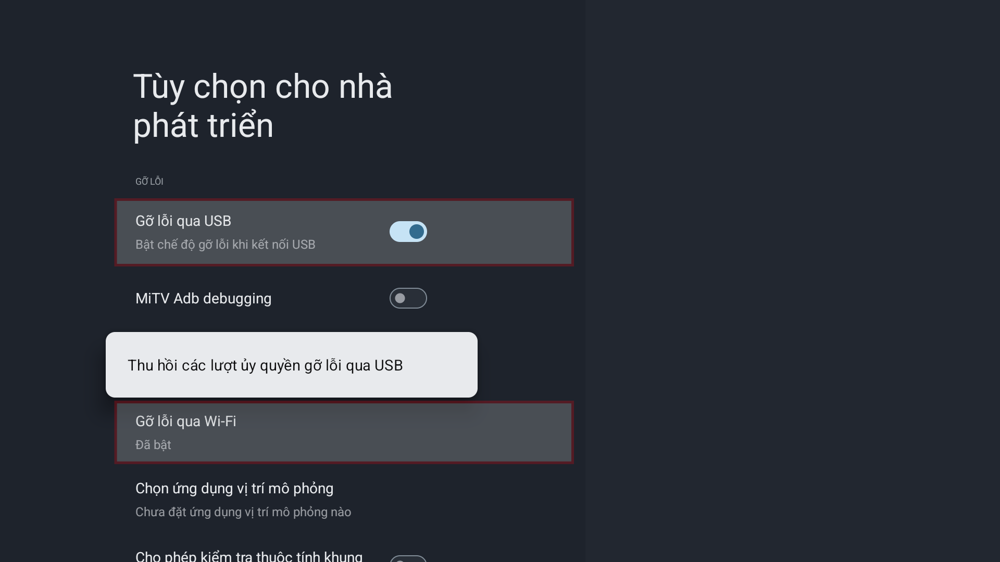
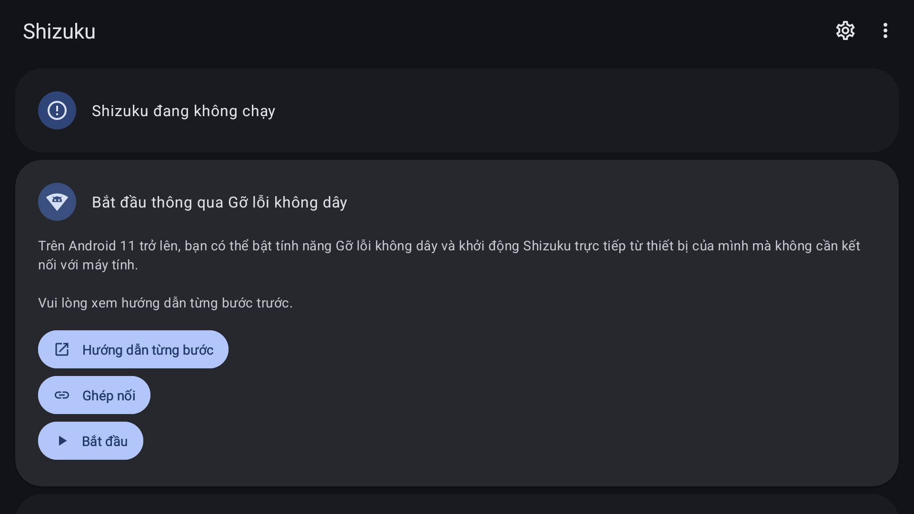
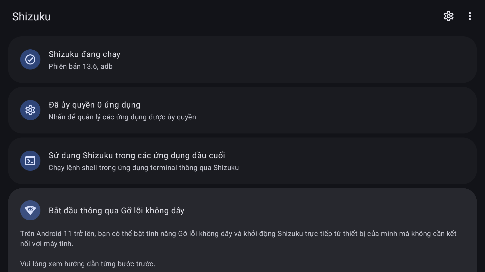
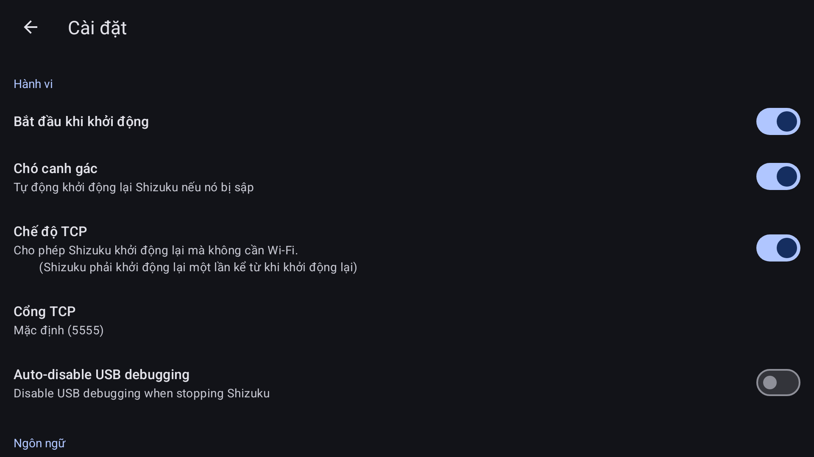
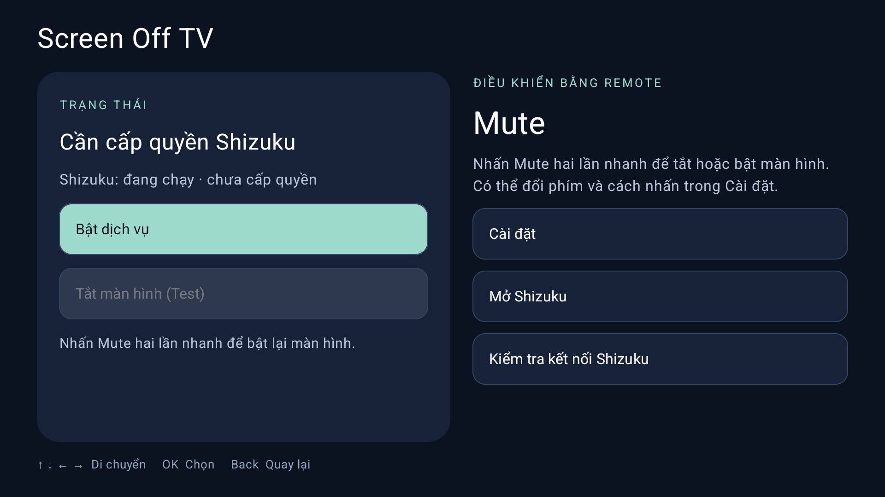
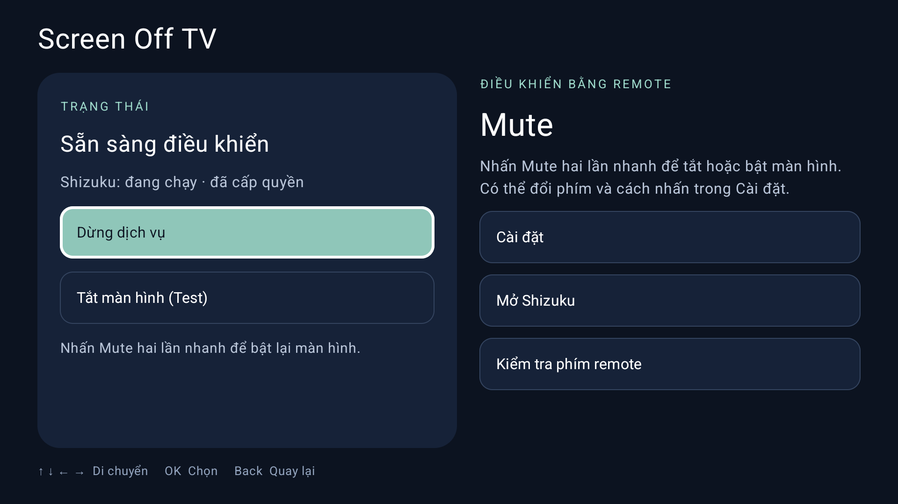
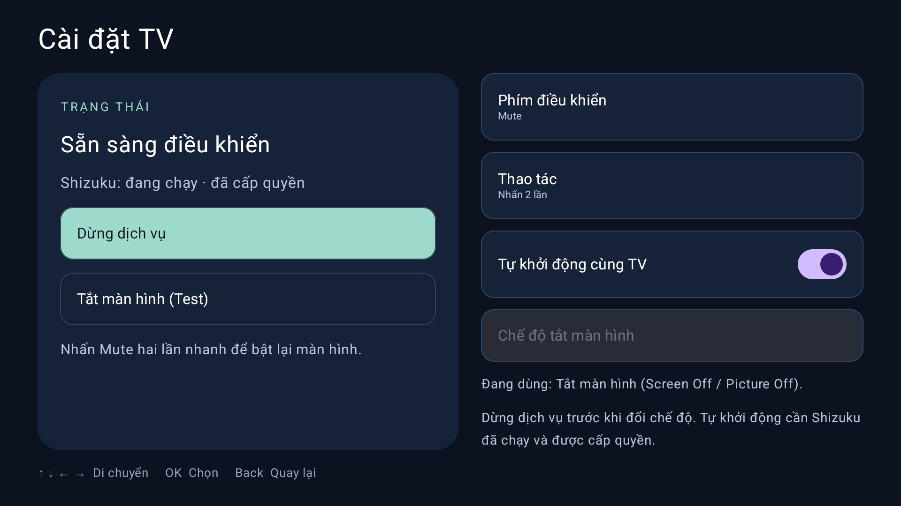
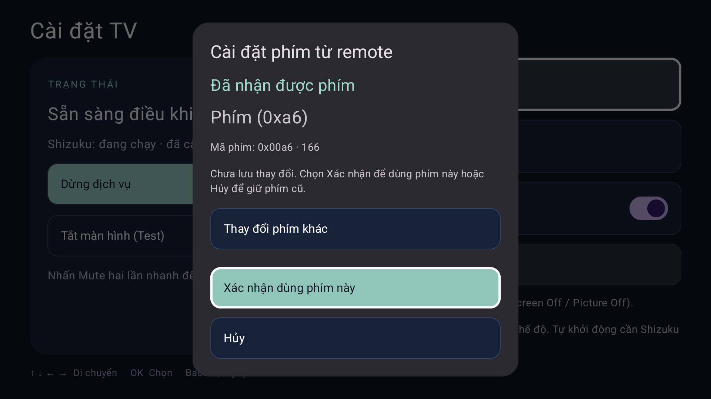
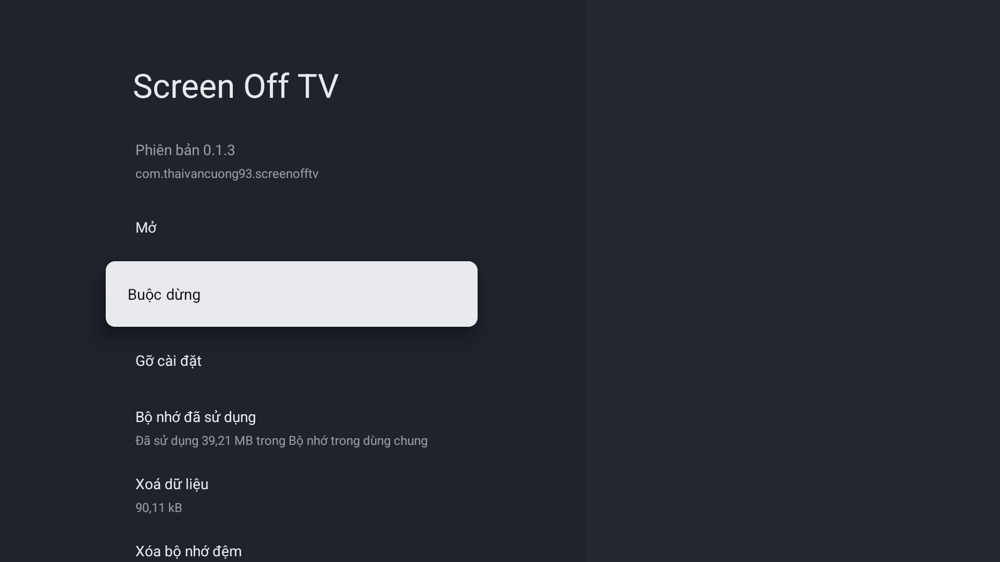

# Cài Screen Off TV trên Android TV / Google TV

[English](INSTALL.en.md) · **Tiếng Việt** · [简体中文](INSTALL.zh-CN.md) · [Hướng dẫn AI agent](AGENT-INSTALL.md) · [README](../README.vi.md)

Cài theo thứ tự dưới đây: **Cài đặt APK Shizuku → Kết nối Shizuku với TV → Bật Shizuku khởi động cùng TV → Cài đặt APK Screen Off TV → Cấp quyền cho Screen Off TV → Kiểm tra tính năng Screen Off TV**.

## 1. Chuẩn bị và tải hai APK

Bạn cần TV có kết nối Wi-Fi, remote điều khiển, máy tính hoặc USB và một ứng dụng quản lý tệp trên TV nếu cài qua USB. Screen Off TV yêu cầu Android TV 8.0 trở lên, khả năng tương thích tùy thuộc firmware của TV. Khởi động Shizuku qua gỡ lỗi không dây cần Android 11 trở lên và firmware có mục Wireless debugging. Hướng dẫn này dùng **thedjchi/Shizuku**, bản fork có giao diện phù hợp remote TV.

| Ứng dụng | Nguồn dự án | Nguồn tải về |
|---|---|---|
| Shizuku 13.7.0-thedjchi | [Trang phát hành](https://github.com/thedjchi/Shizuku/releases/tag/v13.7.0-thedjchi) | [Tải APK](https://github.com/thedjchi/Shizuku/releases/download/v13.7.0-thedjchi/shizuku-v13.7.0-thedjchi.apk) |
| Screen Off TV 0.1.3 | [Trang APK trong repo](https://github.com/ThaiVanCuong93/ScreenOffTV/blob/main/dist/Screen-Off-TV-0.1.3.apk) | [Tải APK](https://github.com/ThaiVanCuong93/ScreenOffTV/raw/refs/heads/main/dist/Screen-Off-TV-0.1.3.apk) |

Đối chiếu SHA-256 bằng `sha256sum TEN_TEP.apk` trên Linux hoặc `Get-FileHash TEN_TEP.apk -Algorithm SHA256` trong PowerShell:

```text
shizuku-v13.7.0-thedjchi.apk
6ea6dee65d5ddc626b6b75b2c2f67f8cc547fa47d7b437e6892639c37eaffe43

Screen-Off-TV-0.1.3.apk
74b80f20adcba6c4e91034b3e581b672dd01c285e5ad879dfadf6d1816cb4b36
```

## 2. Bật chế độ nhà phát triển và gỡ lỗi

1. Mở **Cài đặt → Hệ thống / Tùy chọn thiết bị → Giới thiệu**.
2. Chọn **Bản dựng Android TV OS / Build** và nhấn OK khoảng 7 lần, đến khi TV báo đã là nhà phát triển. Nhập mã khóa TV nếu được yêu cầu.
3. Quay lại **Hệ thống / Tùy chọn thiết bị → Tùy chọn cho nhà phát triển**. Giữ công tắc chính bật.
4. Tìm nhóm **Gỡ lỗi**, bật **Gỡ lỗi qua USB**.
5. Mở **Gỡ lỗi qua Wi-Fi / Wireless debugging**, chọn **Đã bật** và chấp nhận thông báo mạng nếu TV hỏi. Chỉ cho phép máy tính/mạng của bạn.


Ảnh trên chụp sau khi bật chế độ nhà phát triển, gỡ lỗi qua USB và gỡ lỗi qua Wi-Fi. Không bật OEM unlocking hoặc root TV.

## 3. Cài đặt Shizuku APK

**Qua USB:** chép Shizuku APK vào USB, cắm vào TV, mở ứng dụng quản lý tệp, chọn APK Shizuku. Nếu TV chặn cài đặt, vào **Cài đặt → Ứng dụng → Quyền truy cập đặc biệt → Cài ứng dụng không rõ nguồn gốc**, cho phép đúng ứng dụng quản lý tệp đang dùng, quay lại APK và chọn **Cài đặt → Mở**. Có thể thu hồi quyền cài APK của trình quản lý tệp sau khi cài xong. Không tắt bảo vệ hệ thống để bỏ qua một cảnh báo chưa rõ nguyên nhân.

**Qua máy tính:** dùng [SDK Platform Tools của Google](https://developer.android.com/tools/releases/platform-tools). Nếu TV hiển thị cổng ghép đôi/kết nối, dùng đúng hai cổng riêng, nhập mã ghép đôi ở máy tính khi được hỏi:

```bash
adb pair TV_IP:<PAIRING_PORT>
adb connect TV_IP:<CONNECTION_PORT>
adb devices -l
adb -s <TV_SERIAL> install <PATH_TO_APK>/shizuku-v13.7.0-thedjchi.apk
```

Thay các giá trị viết hoa trong dấu `<` và `>` bằng các thông tin tương ứng trên TV của bạn. Chọn **Luôn cho phép từ máy tính này** khi TV hiện hộp thoại ghép đôi.



Thông báo **Shizuku đang không chạy** cho biết dịch vụ Shizuku chưa được khởi động. Sau khi khởi động thành công, trạng thái chuyển thành **Shizuku đang chạy**.

## 4. Kết nối Shizuku với TV

1. Trong Shizuku, chọn **Bắt đầu thông qua Gỡ lỗi không dây → Bắt đầu**.
2. Nếu TV hiện hộp thoại **Cho phép gỡ lỗi qua USB**, tích **Luôn cho phép từ máy tính này** và chọn **Cho phép** cho kết nối của bạn. Chờ quá trình khởi động hoàn tất, màn hình dòng lệnh sẽ tự đóng.
3. Đọc kết quả sau khi bấm Bắt đầu và xác nhận quyền. Nếu Shizuku đã chạy thì không ghép nối lại. Chỉ khi ứng dụng yêu cầu ghép nối hoặc lỗi cho biết chưa ghép nối, chọn **Ghép nối → Tùy chọn nhà phát triển → Gỡ lỗi qua Wi-Fi → Ghép nối thiết bị bằng mã ghép nối**. Cho Shizuku nhận mã hoặc nhập mã theo giao diện thực tế, xác nhận ghép nối thành công rồi quay lại chọn **Bắt đầu**, cho phép gỡ lỗi nếu được hỏi. Máy tính đã ghép nối qua ADB không thay thế bước ghép nối riêng của Shizuku. Với lỗi khác, xử lý theo thông báo.
4. Chỉ tiếp tục khi **Shizuku đang chạy** và không còn hộp thoại chờ xác nhận. Nếu thao tác bằng agent, kiểm tra thêm `pidof shizuku_server` trả về PID. Chỉ ghép nối thành công hoặc đóng màn hình dòng lệnh chưa đủ để kết luận dịch vụ đã chạy.



Nếu TV không có mục gỡ lỗi không dây, trong Shizuku chọn **Bắt đầu bằng cách kết nối với máy tính → Xem lệnh** và chạy đúng lệnh hiển thị qua ADB. Với cách này, cần kiểm tra riêng khả năng tự khởi động sau khi TV khởi động lại.

Bản fork 13.7.0 có thể hiển thị phiên bản server **13.6** trên trang chính, xem phiên bản app trong Giới thiệu hoặc thông tin ứng dụng để đối chiếu đúng `13.7.0-thedjchi`.

## 5. Bật Shizuku khởi động cùng TV

1. Trong Shizuku, chọn biểu tượng bánh răng **Cài đặt**.
2. Bật **Bắt đầu khi khởi động / Start on boot**.
3. Nếu app yêu cầu quyền `WRITE_SECURE_SETTINGS`, dùng máy tính ADB đã cho phép để chạy:

```bash
adb -s TV_SERIAL shell pm grant moe.shizuku.privileged.api android.permission.WRITE_SECURE_SETTINGS
```

4. Giữ Wi-Fi sẵn sàng sau khi TV khởi động. Nếu firmware có mục cho phép chạy nền/tự khởi động, bật cho Shizuku theo menu thực tế của TV.



Ảnh có TCP và Watchdog đều đã được bật. Không yêu cầu phải bật TCP trên mọi TV. Watchdog là tùy chọn tự phục hồi Shizuku khi dịch vụ dừng, không thay thế việc tự khởi động lại Shizuku sau khi khởi động lại TV.

**Lưu ý:** Để Shizuku tự khởi động cùng TV, cần hoàn tất kết nối ở bước 4, bật tùy chọn tự khởi động và giữ Wi-Fi sẵn sàng sau khi TV khởi động. Trên một số Android TV, quá trình khởi động và kết nối Wi-Fi sẽ mất một khoảng thời gian. Screen Off TV tiếp tục chờ Shizuku và tự kết nối lại khi Shizuku sẵn sàng, kể cả khi quá trình này mất hơn 30 giây. Nếu kết nối dịch vụ lỗi, ứng dụng sẽ thử lại, không cần mở lại ứng dụng chỉ vì Shizuku khởi động muộn. Kiểm tra tự chạy ở bước 9.

## 6. Cài Screen Off TV và cấp quyền cho Screen Off TV

Cài `Screen-Off-TV-0.1.3.apk` bằng trình quản lý tệp như bước 3, hoặc từ máy tính:

```bash
adb -s TV_SERIAL install Screen-Off-TV-0.1.3.apk
```

Mở Screen Off TV. Ứng dụng có thể ghi **Cần cấp quyền Shizuku** dù Shizuku đã chạy:



Chọn **Bật dịch vụ**. Tại hộp thoại Shizuku, chọn **Cho phép mọi lúc**. Chấp nhận quyền thông báo nếu TV có hỏi cho Screen Off TV.



Chờ trạng thái **Sẵn sàng điều khiển**, kèm **Shizuku: đang chạy · đã cấp quyền**. Nếu chưa sẵn sàng, mở Shizuku kiểm tra trước rồi quay lại chọn **Kiểm tra kết nối Shizuku** hoặc bật lại dịch vụ.

## 7. Kiểm tra cấu hình mặc định

Vào **Cài đặt** của Screen Off TV và xác nhận:

| Mục | Giá trị |
|---|---|
| Phím điều khiển | Mute |
| Thao tác | Nhấn 2 lần |
| Tự khởi động cùng TV | Bật |
| Chế độ tắt màn hình | Screen Off / Picture Off |
| Ngôn ngữ | Theo hệ thống |



**Lưu ý:** Tùy chọn **Tự khởi động cùng TV** là công tắc riêng của Screen Off TV, phải bật cả mục **Bắt đầu khi khởi động / Start on boot** trong Shizuku ở bước 5. Muốn đổi chế độ tắt màn hình, dừng dịch vụ trước mới có thể thay đổi. Thay đổi ngôn ngữ trong **Cài đặt → Ngôn ngữ**.

## 8. Đổi sang nút RED màu đỏ — tùy chọn

Phím tắt mặc định là **Mute, nhấn hai lần**. Nếu remote có nút màu đỏ và bạn muốn đổi:

1. Bật dịch vụ, mở **Cài đặt → Phím điều khiển → Nhận một phím khác từ remote**.
2. Khi giao diện **Cài đặt phím từ remote** hiện lên, hãy nhấn một lần nút **RED** trên remote. Không chọn Nguồn, OK, Back hay mũi tên.
3. Khi chương trình nhận được mã phím và thông báo **Đã nhận được phím**, chọn **Xác nhận dùng phím này** để lưu lại. Sau khi xác nhận, hộp thoại tự đóng. Chọn **Thay đổi phím khác** để chọn lại phím.
4. Giữ **Thao tác → Nhấn 2 lần** nếu muốn dùng thao tác mặc định. Muốn kiểm tra phím vừa thay đổi, vào **Kiểm tra phím remote**, nhấn phím **RED** một lần để kiểm tra nhận tín hiệu trước.



## 9. Kiểm tra tính năng và tự khởi động

**Kiểm tra tính năng:** Mở bài nhạc/video và xác nhận đang có tiếng. Dùng thao tác đã chọn (mặc định nhấn Mute hai lần nhanh) để tắt hình, kiểm tra âm thanh còn phát là đã thành công. Để bật lại màn hình dùng lại thao tác (mặc định nhấn Mute hai lần nhanh). Phím chức năng trên điều khiển vẫn giữ nguyên chức năng gốc của TV nên hãy thử chức năng gốc trước. Nếu không thể bật lại được màn hình, dùng remote để tắt nguồn TV sau đó khởi động lại TV để thoát khỏi chế độ tắt màn hình.

**Kiểm tra tự khởi động:** Khởi động lại TV bằng menu hệ thống, chờ Wi-Fi và Shizuku tự khởi động. Thời gian chờ tùy TV và tốc độ kết nối Wi-Fi. **Trước khi mở Shizuku hoặc Screen Off TV, không bấm Bật dịch vụ hay chạy lệnh khởi động từ máy tính.** Mở nhạc/video, xác nhận có tiếng rồi dùng phím tắt đã chọn để tắt và bật lại màn hình. Nếu hình tắt/bật được và âm thanh tiếp tục phát, tính năng tự khởi động đã hoạt động trong lần thử này.

Nếu không thành công, kiểm tra tùy chọn tự khởi động của cả hai ứng dụng và xem Shizuku đã chạy chưa. Nếu phải mở ứng dụng hoặc bật dịch vụ thủ công mới dùng được thì lần thử tự khởi động chưa đạt. Khi báo lỗi, ghi model TV, phiên bản Android, phiên bản hai ứng dụng và trạng thái hiển thị. Giữ Wi-Fi sẵn sàng sau khi TV khởi động lại.



Kết quả với Screen Off TV **0.1.2** ngày 25/10/2026: đã reboot hai lần. Cả hai lần, Shizuku và Screen Off TV đều tự chạy **trước khi mở ứng dụng**. Lần thứ hai có ghi nhận chi tiết PID, dịch vụ foreground và nguồn khởi động `BOOT_COMPLETED`. Ảnh minh họa trạng thái sẵn sàng sau khi khởi động lại. Kết quả áp dụng cho TV và firmware đã thử. Chưa thử nhạc/phim với trình phát cụ thể hoặc nút RED trên remote thật.

## 10. Xử lý lỗi nhanh

| Hiện tượng | Cách xử lý |
|---|---|
| Screen Off TV không khởi động sau khi reboot | Kiểm tra lại Screen Off TV đã được cấp quyền, tùy chọn **Tự khởi động cùng TV** đã được bật chưa. Kiểm tra Shizuku có tự khởi động sau khi reboot không |
| Shizuku không thể kết nối | Kiểm tra kết nối Wi-Fi, Gỡ lỗi qua USB và Gỡ lỗi qua Wi-Fi |
| Screen Off TV chưa được cấp quyền | Bật dịch vụ, chọn Cho phép mọi lúc trong Shizuku, nếu đã từ chối, mở danh sách app được ủy quyền trong Shizuku. |
| Shizuku chạy nhưng app chưa sẵn sàng sau boot | Chờ ứng dụng tự kết nối lại. Nếu vẫn lỗi, ghi thông báo trên màn hình và kiểm tra quyền Shizuku. |
| Phim/nhạc dừng khi tắt hình | Kiểm tra trình phát và khôi phục hình. Khả năng tiếp tục phát tùy thuộc trình phát. |

## Nguồn và dữ liệu kiểm tra

- [Shizuku fork](https://github.com/thedjchi/Shizuku), [Setup](https://github.com/thedjchi/Shizuku/wiki/Setup), [Start on boot / Features](https://github.com/thedjchi/Shizuku/wiki/Features).
- [Google Platform Tools](https://developer.android.com/tools/releases/platform-tools), [ADB](https://developer.android.com/tools/adb).
- [Hồ sơ APK cho agent](install-profile.json), [kết quả kiểm tra](TESTING.md), [hướng dẫn agent](AGENT-INSTALL.md).
