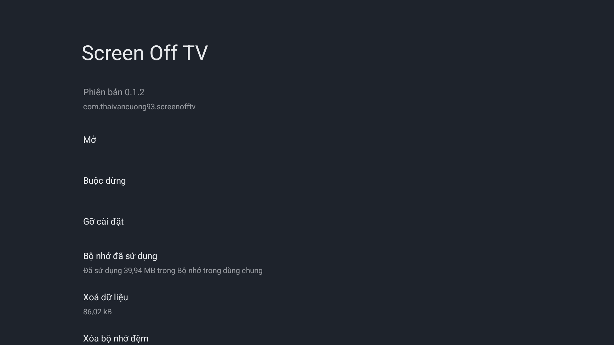
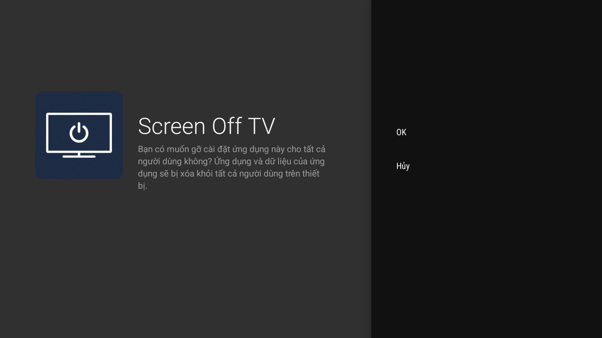
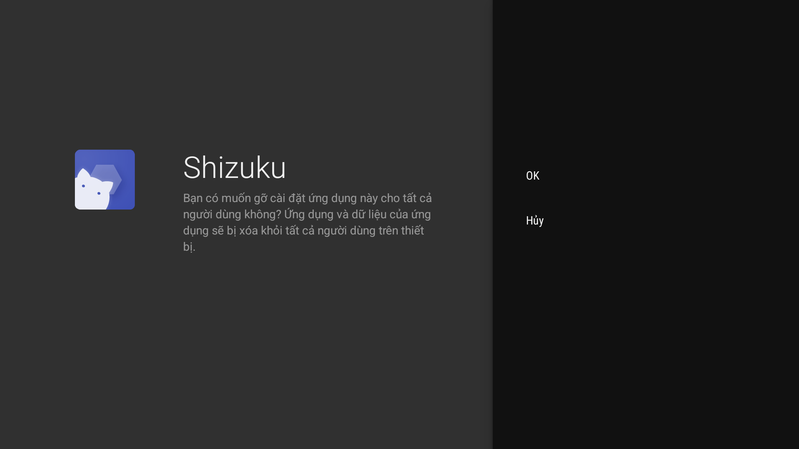
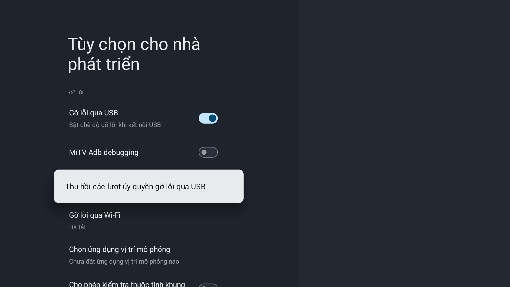
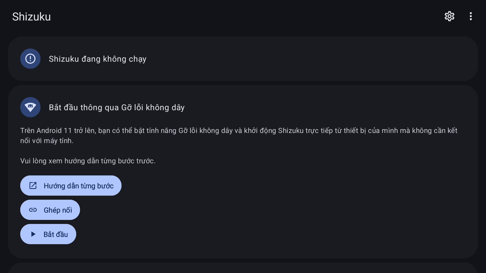
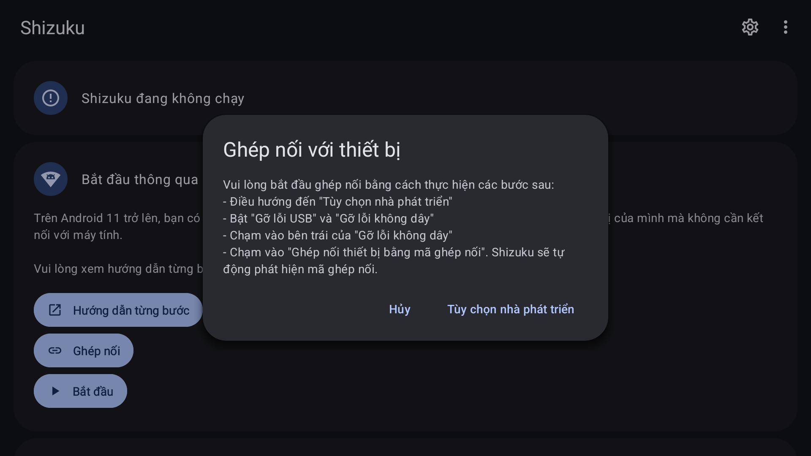
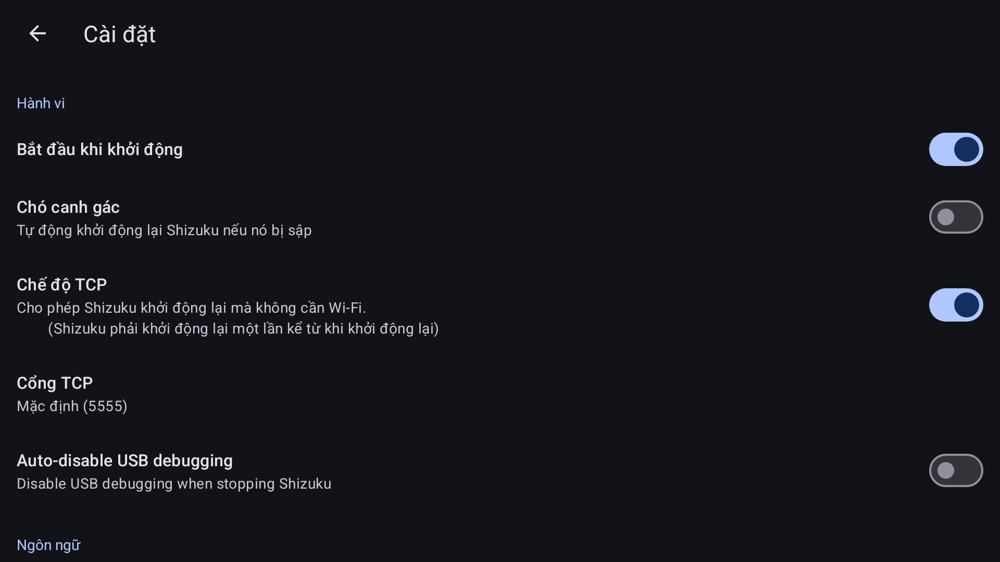
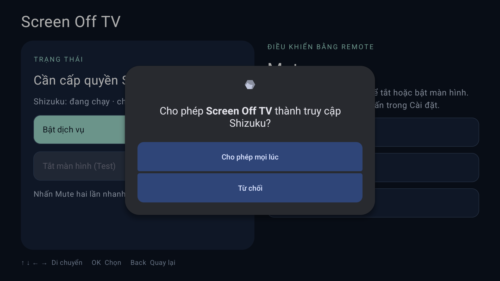

# 在 Android TV / Google TV 上安装 Screen Off TV

[English](INSTALL.en.md) · [Tiếng Việt](INSTALL.md) · **简体中文** · [AI 安装指南（英语）](AGENT-INSTALL.md) · [README](../README.zh-CN.md)

Screen Off TV 用于关闭电视画面并继续播放音乐或视频声音，实际效果取决于电视固件和播放器。项目所有者反馈在 **Xiaomi TV A Pro 55 英寸（2026）** 上使用稳定。2026-10-25 在系统型号 **MiTV-MZTU0、Android 14** 上进行了重新安装、授权和两次重启；第二次在打开应用之前确认两个服务均已自动运行。本次未验证指定播放器的连续音频或真实 RED 按键。[测试记录](TESTING.md)。

以下为电视实拍截图，界面语言为越南语。实际安装通过电脑 ADB 完成；USB 安装步骤以文字说明，没有用应用主界面冒充系统安装器。不同固件的菜单名称可能不同。

## 1. 准备并下载两个 APK

准备遥控器、家庭 Wi-Fi、电脑或 USB 盘；USB 安装需要电视文件管理器。Screen Off TV 要求 Android 8+；无线配对还需要固件提供 Wireless debugging 菜单。

| 应用 | 下载 |
|---|---|
| 适合电视遥控操作的 Shizuku fork 13.7.0-thedjchi | [发布页](https://github.com/thedjchi/Shizuku/releases/tag/v13.7.0-thedjchi) · [APK](https://github.com/thedjchi/Shizuku/releases/download/v13.7.0-thedjchi/shizuku-v13.7.0-thedjchi.apk) |
| Screen Off TV 0.1.2 | [仓库 APK 页面](https://github.com/ThaiVanCuong93/ScreenOffTV/blob/main/dist/Screen-Off-TV-0.1.2.apk) · [APK](https://github.com/ThaiVanCuong93/ScreenOffTV/raw/refs/heads/main/dist/Screen-Off-TV-0.1.2.apk) |

先下载两个文件，再卸载旧版本。GitHub 文件页面选择 **Download raw file**，不要把 HTML 网页保存为 APK。在 Linux 用 `sha256sum 文件.apk`，在 PowerShell 用 `Get-FileHash 文件.apk -Algorithm SHA256`，对照：

```text
shizuku-v13.7.0-thedjchi.apk
6ea6dee65d5ddc626b6b75b2c2f67f8cc547fa47d7b437e6892639c37eaffe43
Screen-Off-TV-0.1.2.apk
96860596bfaec0f69f3f98f5f73f2b96d6f0fea57abe067cbed5d58ff5244fd4
```

这里选用 **thedjchi/Shizuku fork**，不是 RikkaApps 发布包。fork 作者目前暂停维护，后续升级前应重新检查源仓库。Screen Off TV 是使用 Android debug key 签名的测试版。[APK 与证书资料](install-profile.json)。

## 2. 更新还是全新安装

同一签名的普通更新可覆盖安装以保留设置，无需每次卸载。

需要从头安装时：**电视设置 → 应用 → 查看所有应用 → Screen Off TV → 卸载 → OK**，再对 Shizuku 重复。卸载会删除应用设置、Shizuku 配对数据与授权，需要重新设置。







RikkaApps 原版与 thedjchi fork 包名相同、证书不同。迁移时先卸载原版；在 **无线调试 → 已配对设备** 中仅忘记能够确认的旧 Shizuku 项，再安装并配对 fork，重新授权 Screen Off TV。保留电脑配对，不要撤销所有调试授权。仅切换 Shizuku 不需要卸载 Screen Off TV。

## 3. 开启开发者选项与调试

1. **设置 → 系统 / 设备偏好设置 → 关于 → Android TV OS 版本号 / Build**，按 OK 约 7 次，直到提示已成为开发者；如要求，输入电视锁屏码。
2. 返回 **系统 / 设备偏好设置 → 开发者选项**，保持总开关开启。
3. 在调试部分开启 **USB 调试**。
4. 进入 **无线调试 / Wireless debugging**（图中越南语为 **Gỡ lỗi qua Wi-Fi**），选择开启；如有网络授权提示，仅允许自己的可信网络。不要开启 OEM 解锁或 root 电视。



截图拍摄时无线调试尚未开启，下一步应进入该行并选择开启。测试电视已提前启用开发者选项，因此没有最初连续点击 Build 的截图。

## 4. 先安装 Shizuku

**USB 方法：**把两个 APK 复制到 USB 盘，插入电视，用电视文件管理器打开 Shizuku APK。如被阻止，进入 **设置 → 应用 → 特殊应用权限 → 安装未知应用**，仅允许当前文件管理器，再返回选择 **安装 → 打开**。安装完成后可收回该文件管理器的安装权限。不要为绕过原因不明的警告关闭系统保护。

**电脑方法：**安装 [Google Platform Tools](https://developer.android.com/tools/releases/platform-tools)。使用电视当前显示的配对端口和连接端口，两者不同；在电脑提示时输入当前配对码，并在电视允许自己的电脑：

```bash
adb pair TV_IP:PAIRING_PORT
adb connect TV_IP:CONNECTION_PORT
adb devices -l
adb -s TV_SERIAL install shizuku-v13.7.0-thedjchi.apk
```

将大写占位符替换为实际值。若固件提供已授权的旧式网络 ADB，可使用该途径；不要假定所有电视都使用 5555 端口。电脑已配对不代表 Shizuku 自身已配对。

从应用列表打开 Shizuku；若找不到图标，可用 **设置 → 应用 → Shizuku → 打开**。



## 5. 配对 Shizuku 自身的密钥

1. 在 Shizuku 选择 **通过无线调试启动 → 配对**（Ghép nối）。
2. 在提示框选择 **开发者选项**（Tùy chọn nhà phát triển）。
3. **无线调试 → 使用配对码配对设备**，保持配对码页面打开，让 Shizuku 自动识别。不要公开仍有效的配对码。
4. 返回 Shizuku；如未运行，选择 **启动**（Bắt đầu），直到显示正在运行。旧配对列表或仅返回主界面不能单独证明新配对成功，应继续验证无线启动或重启恢复。



若设置页面提前返回提示框，尝试直接用遥控器。AI 操作时避免在自动配对期间使用 `uiautomator dump` 或其他竞争 UiAutomation 的工具，改用截图与方向键。

**电脑备用启动：**在 Shizuku 的通过电脑启动部分选择 **查看命令**，通过已授权 ADB 执行应用实际显示的命令。安装路径每次可能变化，不要复制其他电视的固定路径。仅用电脑启动不证明无线开机恢复成功。fork 应用版本 13.7.0 的主页可能显示 server 13.6，应用版本应查看关于或系统应用信息。

## 6. 设置 Shizuku 开机自启动

进入 Shizuku **齿轮 → 设置 → 开机时启动 / Start on boot**（Bắt đầu khi khởi động），开启。如果安装流程要求 WRITE_SECURE_SETTINGS，通过已授权电脑运行：

```bash
adb -s TV_SERIAL shell pm grant moe.shizuku.privileged.api android.permission.WRITE_SECURE_SETTINGS
```

重启后保持 Wi-Fi 可用；若固件有真实的后台运行/自启动管理菜单，为 Shizuku 设置相应权限。



图中 TCP 开启、Watchdog 关闭，是测试电视状态，不代表每台电视都必须如此设置。无需修改 TCP 端口或 root 设备。Watchdog 可选，不能代替重启验证。Shizuku 可能等待 Wi-Fi 数分钟，而 Screen Off TV 当前等待约 30 秒；若超时，等 Shizuku 就绪后重新启动应用服务，并如实记录该次自动恢复未成功。

## 7. 安装 Screen Off TV 并授权

按步骤 4 的 USB 方法安装，或运行：

```bash
adb -s TV_SERIAL install Screen-Off-TV-0.1.2.apk
```

打开 Screen Off TV，选择 **启动服务 / Bật dịch vụ**。首次安装可能提示需要 Shizuku 权限：


在 Shizuku 弹窗选择 **始终允许 / Cho phép mọi lúc**。若电视要求该应用的通知权限，接受相应提示。



等待显示就绪、Shizuku 正在运行且已授权。否则先检查 Shizuku，再返回检查连接或重新启动服务。

## 8. 确认默认设置

Screen Off TV **设置 → 遥控按键：Mute；操作：快速双击；随电视启动：开启；息屏模式：Screen Off / Picture Off**。Shizuku 和 Screen Off TV 两个开机启动开关都要配置。修改息屏模式前先停止服务；可在设置 → 语言选择中文。普通更新保留已有语言选择。


## 9. 可选：更换为 RED 红色按键

默认仍是 Mute。若遥控器有红色键：启动服务 → 设置 → 遥控按键 → 学习其他遥控按键 → 等待时按一次真实 RED → 检查检测到的名称/代码 → 确认使用。保留双击，在测试按键页面先单击检查。不要选择电源、OK、Back 或方向键；不要猜测厂商代码。没有 RED 或识别失败时保留 Mute，选择列表中的 Mute 可恢复默认。ADB 注入事件不能证明真实按键已识别。本次未进行物理 RED 测试，所以没有该部分截图。

## 10. 验证画面、声音及开机恢复

播放音乐或视频并确认有声音。默认快速按两下 Mute 关闭画面，检查声音是否持续，再执行同样操作恢复画面并检查播放状态。该键保留电视原功能，请先测试操作，并准备遥控器唤醒电视；无法恢复时不要继续尝试。记录播放器/版本和息屏模式。ADB 截图在面板关闭时可能仍有图像，应通过眼睛或摄像机确认真实面板。

通过系统菜单重新启动电视，等待 Wi-Fi/Shizuku，**先不要打开应用或点启动服务**，由 agent 检查服务或用真实快捷键验证，再打开应用查看就绪。必须打开应用才恢复时，不应记录为独立自启动成功。


本机第二次重启在打开应用前确认两项服务运行，Android 记录启动来源为 `BOOT_COMPLETED`。两次重启是本机测试结果，不是所有固件的长期稳定保证。本次仍未验证指定播放器的息屏连续声音或真实 RED 按键。

## 11. 常见问题

| 问题 | 处理 |
|---|---|
| 没有无线调试菜单 | 使用 Shizuku 查看命令的电脑启动方式，不承诺该固件支持无 root 开机恢复。 |
| 无法识别配对码 | 重新进入配对，用遥控器显示新码，保持 Wi-Fi，避免并行 UiAutomation。 |
| 签名冲突 | 确认安装来源；原版切换 fork 需要卸载原版，不要重置电视。 |
| 尚未授权 | 启动服务并始终允许；曾拒绝时查看 Shizuku 的已授权应用。 |
| Shizuku 就绪但客户端超时 | 等 Shizuku 运行后重新启动客户端服务，并记录自动恢复未成功。 |
| 播放停止 | 恢复画面，检查播放器；停止服务后可试另一种息屏模式，不保证所有播放器兼容。 |

参考：[fork](https://github.com/thedjchi/Shizuku)、[Setup](https://github.com/thedjchi/Shizuku/wiki/Setup)、[Features](https://github.com/thedjchi/Shizuku/wiki/Features)、[Google ADB](https://developer.android.com/tools/adb)。另见 [AI 指南](AGENT-INSTALL.md) 与 [测试记录](TESTING.md)。
