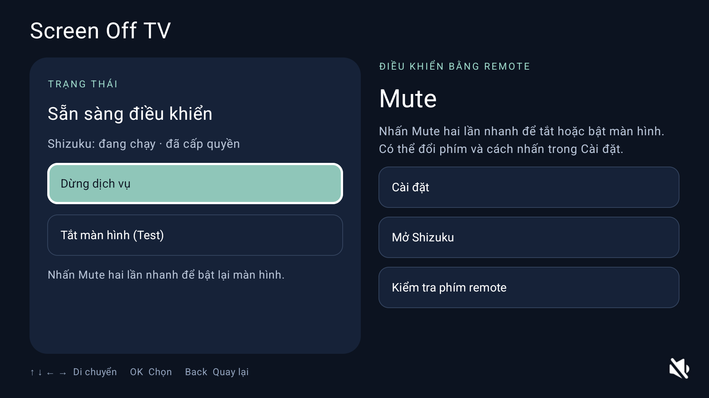

# Screen Off TV 0.1.2 — test evidence

Recorded on 2026-10-25. Application ID: `com.thaivancuong93.screenofftv`, versionCode 2.
This document records observed results; it is not a compatibility certification for every TV or player.

## Device

| Property | Observed value |
|---|---|
| Manufacturer | Xiaomi |
| Model | MiTV-MZTU0 |
| Android version | 14 |
| Android API | 34 |
| Connection | ADB; device network address omitted |

The model and version were read from the connected TV using Android system properties. A device model identifies the test unit; another firmware revision may behave differently.

## Completed checks

| Check | Result | Evidence / scope |
|---|---|---|
| APK build | Passed | `:app:assembleDebugSignedDebug` completed successfully. |
| Remote gesture unit tests | 7 passed | `RemoteGestureDetectorTest`: single/double/hold handling, cancellation/reset and reserved keys. |
| IPC result unit test | 1 passed | `ResultTest`: success and failure paths remain distinct. |
| Android UI/resource tests on TV | 6 passed | AndroidJUnitRunner ended with `OK (6 tests)`. |
| Android lint | Passed | `:app:lintDebugSignedDebug` completed successfully in the language implementation check. |
| Live screenshots | Checked | Real localized home screens in `fastlane/metadata/android/`; installation screenshots in `docs/images/install/`. |
| Installed version | Confirmed | TV package manager reported 0.1.2 / versionCode 2. |

The six Android tests cover:

1. English, Vietnamese and Simplified Chinese strings, privacy resources and translated service messages.
2. English fallback for an unsupported system language.
3. Persistence of the language choice without changing remote preferences.
4. Start on boot enabled when unset, with an explicitly stored opt-out respected.
5. About scrolling with D-pad and closing with OK.
6. Live language switching while preserving the selected screen-off mode in the UI test repository.

The UI tests do not turn the panel off, play a movie/music track or reboot the TV. A live service under continuous media playback was not exercised by those tests.

## Tests still needed for playback compatibility

For each screen-off mode, record an actual player name/version, content type, panel result, audio continuity, ability to restore the picture and relevant firmware version. Boot recovery with configured Shizuku was tested below; the Shizuku-unavailable/delayed-beyond-timeout case remains unverified.

Do not mark a player supported solely because the app installs or the UI tests pass.

## Compatibility report template

```text
Screen Off TV version:
TV manufacturer/model:
Firmware/build version:
Android version/API:
Shizuku version and startup method:
Player name/version:
Content: music / podcast / movie / other video
Screen-off mode:
Remote key and press action:
Panel turned off:
Audio continued:
Picture restored using the same shortcut:
Playback position/state after restoring:
Reboot/start-on-boot result, if tested:
Other observations:
```

## Reproduce the automated checks

With JDK 17 and Android SDK platform 35 configured:

```bash
./gradlew :app:assembleDebugSignedDebug :app:testDebugSignedDebugUnitTest :ipc:testDebugUnitTest
./gradlew :app:connectedDebugSignedDebugAndroidTest
./gradlew :app:lintDebugSignedDebug
```

Run the connected tests on an awake TV with no other UI automation running. The tests temporarily change language/start-on-boot preferences and restore their saved values.

## Owner-reported device experience

On 2026-10-25 the project owner reported stable operation on **Xiaomi TV A Pro 55-inch (2026)**. This is recorded as owner usage feedback. A named player/version, test duration, firmware and a full reboot record were not supplied in that report; do not convert it into a long-duration lab result.

## Fresh installation and boot recovery — 2026-10-25

- Uninstalled Screen Off TV and Shizuku via TV Settings, confirmed the target packages were absent, then installed both validated APKs through ADB.
- Installed Screen Off TV 0.1.2 / versionCode 2 and thedjchi/Shizuku 13.7.0-thedjchi / versionCode 1361. The fork home page reports server 13.6; this does not change the app version.
- Granted Shizuku authorization to Screen Off TV; confirmed Ready, Mute double press, Screen Off / Picture Off and the app boot switch enabled. Fork Start on boot was also enabled; TCP was enabled, Watchdog disabled.
- Pairing flow completed using screenshots/remote navigation after avoiding competing UiAutomation. The original workstation pairings were preserved.
- Rebooted twice. In the first run the app UI was opened during observation, so that run alone does not isolate client auto-start.
- In the second run, before opening either app, sys.boot_completed=1, shizuku_server had a PID and ScreenOffTVService was foreground. Android recorded allowStartForeground=BOOT_COMPLETED and createdFromFg=false. No PC starter or Start service click was used in that run. Opening the UI afterwards showed Ready.



This verifies the observed startup chain on this device, not long-term stability or every firmware. The missing-Shizuku timeout case, physical RED learning and named-player panel/audio continuity remain unverified. USB installer, original Build-tapping flow and download-page screenshots were not captured; the manuals describe those paths without fabricating images.

[Illustrated installation guide](INSTALL.en.md) · [AI agent runbook](AGENT-INSTALL.md)
